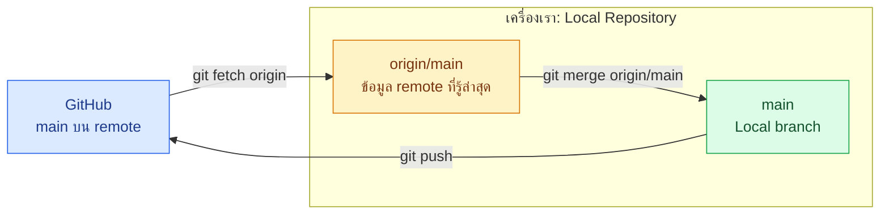
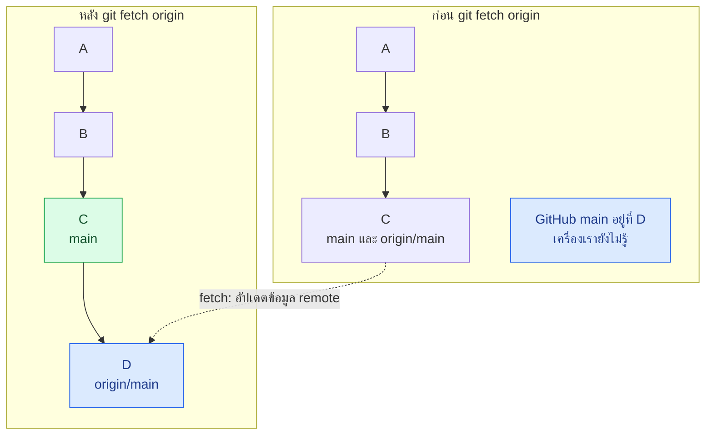
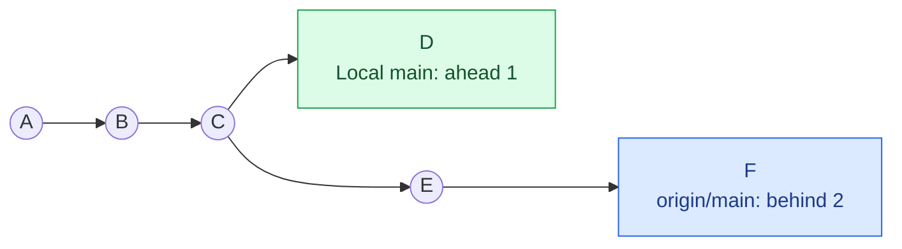
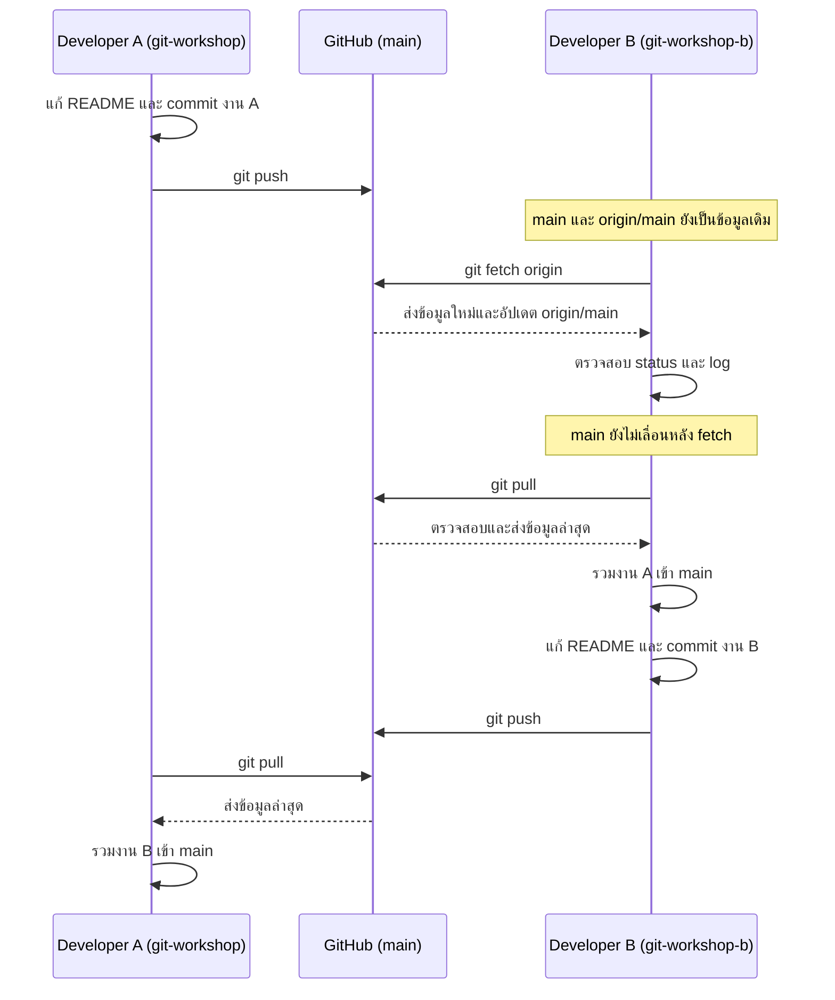
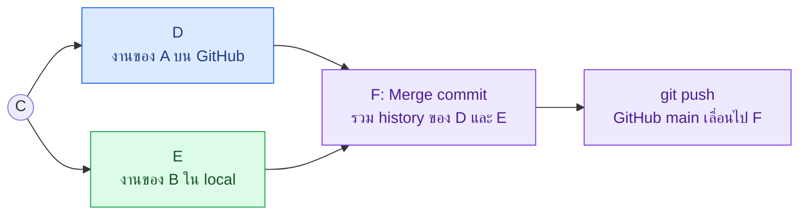
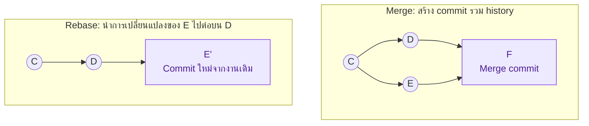

# Workshop 11: Fetch / Pull / Push

> เข้าใจว่า Local กับ Remote แลกเปลี่ยน commit กันอย่างไร ผ่าน `git fetch`, `git pull` และ `git push`

บทนี้ต่อจาก Workshop 10 ซึ่งเราได้เชื่อม Local Repository กับ GitHub และตั้ง upstream ให้ branch แล้ว เป้าหมายคือแยกสามคำสั่งนี้ให้ชัด และทดลองทำงานร่วมกันผ่าน repository สองโฟลเดอร์

| คำสั่ง | จำง่าย ๆ | ผลต่อ local branch ปัจจุบัน |
|---|---|---|
| `git fetch` | ดาวน์โหลดข้อมูลใหม่จาก remote มาให้ตรวจสอบ | ยังไม่รวมงานเข้า branch |
| `git pull` | ดาวน์โหลดข้อมูลใหม่ แล้วรวมเข้ากับ branch เรา | อาจเลื่อน branch หรือรวม history ตามวิธีที่เลือก |
| `git push` | ส่ง commit ของเราขึ้น remote | ส่งสิ่งที่ commit แล้ว ไม่ได้สร้าง local commit ใหม่ |

## สารบัญ

- [ภาพรวม: ข้อมูลอยู่ตรงไหน?](#overview)
- [Step 1–7: เข้าใจและใช้งานสามคำสั่ง](#commands)
- [อ่านสถานะ Ahead / Behind / Diverged](#branch-status)
- [Step 8–13: Lab จำลอง Developer A และ B](#two-developers)
- [Step 14: ทำไม Push ถูก Reject?](#push-rejected)
- [Fetch vs Pull และภาพรวม Rebase](#fetch-pull-rebase)
- [Workflow ที่แนะนำ](#workflows)
- [Workshop Challenge](#challenge)
- [สรุปและตารางคำสั่ง](#summary)

---

<a id="overview"></a>

## ภาพรวม: ข้อมูลอยู่ตรงไหน?

ก่อนเริ่ม ให้แยกสามสิ่งนี้ออกจากกัน:

| ชื่อ | อยู่ที่ไหน? | หมายถึงอะไร? |
|---|---|---|
| `main` | เครื่องเรา | Local branch ที่เราทำงานอยู่ |
| `origin/main` | เครื่องเรา | Remote-tracking branch ใช้จำสถานะล่าสุดที่รู้ของ `main` บน remote |
| `main` บน GitHub | Server ของ GitHub | Branch จริงบน remote ซึ่งคนอื่นอาจ push เพิ่มได้ |



การเดินตามลูกศร **fetch → merge** เป็น workflow แบบแยกขั้น ส่วน `pull` จะ fetch แล้วรวมข้อมูลเข้ากับ branch ปัจจุบัน โดยวิธีรวมขึ้นอยู่กับ option และการตั้งค่า

> [!IMPORTANT]
> `origin/main` อยู่ในเครื่องเรา และอาจยังไม่ตรงกับ GitHub ในขณะนั้น ต้องติดต่อ remote เพื่ออัปเดตข้อมูลก่อน

แผนภาพในบทนี้ใช้ Mermaid สามารถดูเป็นภาพได้ผ่าน Markdown Preview ที่รองรับ Mermaid หรือบน GitHub

---

<a id="commands"></a>

## Step 1: เช็กสถานะก่อน

เข้า repository เดิม กลับมาที่ `main` แล้วตรวจสอบสถานะ:

```bash
cd git-workshop
git switch main
git status
git branch -vv
```

ตัวอย่างผลลัพธ์:

```text
* main abc1234 [origin/main] docs: update README
```

ส่วน `[origin/main]` หมายความว่า local `main` ตั้ง upstream เป็น `origin/main`

> [!NOTE]
> ตัวอย่างในบทนี้สมมติว่า remote ชื่อ `origin`, branch หลักชื่อ `main` และตั้ง upstream แล้ว ควร commit หรือ stash งานค้างก่อนเริ่ม Lab

---

## Step 2: `origin/main` ไม่ใช่ GitHub แบบสด ๆ

สมมติทุกฝ่ายเคยอยู่ที่ commit `C` แต่มีคน push commit `D` ขึ้น GitHub แล้ว:

```text
GitHub จริง
A → B → C → D
            ↑
           main

Local ที่เครื่องเรา
A → B → C
        ↑
  main / origin/main
```

| ตำแหน่ง | Commit ที่ชี้อยู่ | สิ่งที่เกิดขึ้น |
|---|---|---|
| `main` บน GitHub | `D` | มี commit ใหม่แล้ว |
| Local `main` | `C` | ยังไม่มีงานใหม่ใน branch |
| Local `origin/main` | `C` | ยังไม่รู้ว่า remote เปลี่ยนไปแล้ว |

เครื่องเรายังคิดว่า remote อยู่ที่ `C` จนกว่าจะติดต่อ remote เช่น:

```bash
git fetch origin
```

---

## Step 3: `git fetch`

`fetch` ดาวน์โหลด commit และข้อมูลที่จำเป็นจาก remote พร้อมอัปเดต remote-tracking branches ในเครื่องเรา ตามการตั้งค่าของ repository

ใช้คำสั่ง:

```bash
git fetch
```

หรือระบุ remote ให้ชัดเจน:

```bash
git fetch origin
```

### ก่อนและหลัง Fetch



**`main` ยังอยู่ที่ `C`** ส่วน `origin/main` เลื่อนไป `D` แล้ว การ fetch ตามปกติไม่ได้รวมโค้ดเข้ากับ branch ปัจจุบัน และไม่แก้ไฟล์ใน Working Directory

ลองตรวจสอบหลัง fetch:

```bash
git status
```

Git อาจแสดง:

```text
Your branch is behind 'origin/main' by 1 commit.
```

หมายความว่า `origin/main` มี commit ที่ local `main` ยังไม่มีอยู่ 1 commit

> [!TIP]
> ใช้ `git fetch origin` ตามด้วย `git status` เมื่อต้องการตรวจสอบสถานการณ์ก่อนนำงานใหม่มารวม

---

## Step 4: ดูว่า Remote เพิ่มอะไรมา

หลัง fetch ให้ดู commit ที่ `origin/main` มี แต่ `main` ยังไม่มี:

```bash
git log --oneline main..origin/main
```

ตัวอย่างผลลัพธ์:

```text
82fa931 fix: validate employee status
```

อ่าน `main..origin/main` ว่า **commit ที่อยู่ใน `origin/main` แต่ไม่ได้อยู่ใน `main`** จึงตรวจดูก่อนได้ว่า remote มีอะไรใหม่ก่อนนำเข้ามา

---

## Step 5: นำงานจาก Remote มารวม

เมื่ออยู่ที่ `main` และ fetch แล้ว สามารถรวมข้อมูลจาก `origin/main` ได้:

```bash
git merge origin/main
```

หากต้องการเห็นขั้นตอนครบตั้งแต่ต้น:

```bash
git switch main
git fetch origin
git merge origin/main
```

ภาพรวมแนวคิด:

```text
Fetch ข้อมูลล่าสุด
        ↓
ตรวจสอบ commit ที่เพิ่มมา
        ↓
Merge origin/main เข้า main
```

นี่คือพื้นฐานของ **pull แบบ merge**: fetch ก่อน แล้วนำ branch ที่ได้มารวมกับ branch ปัจจุบัน

> [!NOTE]
> `git pull` อาจรวมงานด้วย fast-forward, merge หรือ rebase ตาม option และการตั้งค่า จึงไม่ควรจำว่า pull จะสร้าง merge commit ทุกครั้ง

---

## Step 6: `git pull`

หากไม่ต้องการแยกขั้น ให้ใช้:

```bash
git pull
```

Git จะ fetch ข้อมูลล่าสุด แล้วรวม branch ต้นทางเข้ากับ local branch ปัจจุบัน

กรณี local ไม่มี commit แยกออกมา และ remote มี `D` เพิ่มเพียง commit เดียว:

```text
ก่อน Pull
Local main:  A → B → C
Remote main: A → B → C → D

หลัง Pull สำเร็จ
Local main:  A → B → C → D
Remote main: A → B → C → D
```

กรณีนี้ branch สามารถเลื่อนไป `D` แบบ **fast-forward** ได้ โดยไม่ต้องสร้าง merge commit

### `git pull` รู้ได้อย่างไรว่าจะดึงจากไหน?

ใน Workshop 10 เราเคยใช้:

```bash
git push -u origin main
```

คำสั่งนี้ตั้ง upstream ให้ local `main` ติดตาม `origin/main` เมื่ออยู่ที่ `main` แล้วใช้ `git pull` Git จึงรู้ว่าจะ fetch จาก `origin` และรวม branch `main` ของ remote เข้ามา

หาก clone repository มา Git มักตั้ง upstream ให้ default branch อยู่แล้วเช่นกัน

---

## Step 7: `git push`

`push` ส่ง commit จาก local ไป remote ซึ่งเป็นทิศทางกลับกันกับการดึงข้อมูล

สมมติแก้ไฟล์และ commit งานแล้ว:

```bash
git add .
git commit -m "feat: add employee filter"
```

ตอนนี้สถานะเป็นแบบนี้:

```text
Remote main: A → B → C
Local main:  A → B → C → D
```

Git อาจแสดง:

```text
Your branch is ahead of 'origin/main' by 1 commit.
```

ส่ง commit ขึ้น remote:

```bash
git push
```

เมื่อสำเร็จและไม่มีงานใหม่จากคนอื่นแทรกเข้ามา:

```text
A → B → C → D
            ↑
  main / origin/main / GitHub main
```

> [!IMPORTANT]
> `git push` ส่งสิ่งที่ commit แล้วขึ้น remote ไฟล์ที่แก้แต่ยังไม่ได้ commit จะไม่ถูกส่งไปด้วย

---

<a id="branch-status"></a>

## อ่านสถานะ Ahead / Behind / Diverged

สถานะเหล่านี้เปรียบเทียบ **local branch กับ upstream ที่เครื่องเรารู้ล่าสุด** ควร fetch ก่อนเมื่อต้องการตรวจสอบข้อมูลใหม่จาก remote

| สถานะ | หมายความว่าอย่างไร? | ขั้นตอนที่ควรพิจารณา |
|---|---|---|
| **Ahead 2** | Local มี 2 commit ที่ `origin/main` ไม่มี | ตรวจสอบแล้ว `git push` |
| **Behind 3** | `origin/main` มี 3 commit ที่ local ไม่มี | ตรวจสอบแล้ว `git pull` หรือ merge หลัง fetch |
| **Ahead 1, Behind 2** | ทั้งสองฝั่งมี commit ของตัวเอง ประวัติแยกสายแล้ว | Fetch แล้วรวม history ก่อน push |

### Ahead

```text
Your branch is ahead of 'origin/main' by 2 commits.
```

Local เดินนำ upstream ที่รู้ล่าสุดอยู่ 2 commit

### Behind

```text
Your branch is behind 'origin/main' by 3 commits.
```

Local ยังขาด 3 commit ที่มีอยู่ใน upstream ที่รู้ล่าสุด

### Diverged: Ahead และ Behind พร้อมกัน

ตัวอย่างข้อความ:

```text
Your branch and 'origin/main' have diverged,
and have 1 and 2 different commits each.
```



ทั้ง local และ remote มี commit ใหม่คนละชุด การ push ตามปกติจึงถูกปฏิเสธหาก remote ยังมี history ที่ local ไม่ได้รวมไว้

Workflow แบบ merge ที่เห็นขั้นตอนชัดเจน ขณะอยู่ที่ `main`:

```bash
git fetch origin
git merge origin/main
```

หากมี conflict ให้แก้ไขและทำ merge ให้เสร็จก่อน แล้วจึง:

```bash
git push
```

หากต้องการ pull แบบ merge โดยระบุวิธีรวมให้ชัดเจน ใช้ `git pull --no-rebase` ได้ หาก repository ตั้งให้รับเฉพาะ fast-forward อาจต้องใช้ workflow แยก `fetch` และ `merge` ด้านบน

---

<a id="two-developers"></a>

## Lab: จำลอง Developer A และ B

เราจะใช้ repository สองโฟลเดอร์แทน developer สองคน แต่เชื่อมไปยัง GitHub repository เดียวกัน

| ผู้พัฒนา | โฟลเดอร์ | Remote |
|---|---|---|
| **Developer A** | `git-workshop` | GitHub repository เดิม |
| **Developer B** | `git-workshop-b` | GitHub repository เดียวกับ A |

> [!TIP]
> เปิด Terminal แยกสำหรับ A และ B จะสลับทำตามขั้นตอนได้ง่ายขึ้น ให้ทั้งสองฝั่งทำงานบน `main` และใช้ repository สำหรับฝึกที่คุณ push ได้

### ภาพรวมการส่งต่องาน



---

## Step 8: เตรียม Repository สองโฟลเดอร์

สมมติ Terminal ของ A อยู่ใน `git-workshop` ให้กลับไปยังโฟลเดอร์แม่ แล้ว clone เพิ่ม:

```bash
cd ..
git clone <repository-url> git-workshop-b
```

แทน `<repository-url>` ด้วย URL เดียวกับ `origin` ของ repository เดิม ตอนนี้จะมีโฟลเดอร์ข้างกัน:

```text
โฟลเดอร์แม่/
├── git-workshop/      ← Developer A
└── git-workshop-b/    ← Developer B
```

ทั้งสองโฟลเดอร์มี `.git` และสถานะ local ของตัวเอง จึงต้อง fetch หรือ pull แยกกัน

---

## Step 9: Developer A Push งานใหม่

จากโฟลเดอร์แม่ เข้าโฟลเดอร์ A และอัปเดต `main`:

```bash
cd git-workshop
git switch main
git pull
```

เพิ่มข้อความใน `README.md`:

```text
Developer A update
```

จากนั้น commit และ push:

```bash
git add README.md
git commit -m "docs: add developer A note"
git push
```

ตอนนี้ GitHub มี commit ใหม่ของ A แล้ว

---

## Step 10: Developer B ยังไม่รู้

เปิด Terminal อีกหน้าที่โฟลเดอร์แม่ แล้วเข้าโฟลเดอร์ B:

```bash
cd git-workshop-b
git switch main
git log --oneline
```

ยังไม่เห็น commit ใหม่ของ A เพราะ B ยังไม่ได้ติดต่อ remote หลัง A push

ลอง fetch แล้วตรวจสอบ:

```bash
git fetch origin
git status
```

อาจเห็น:

```text
Your branch is behind 'origin/main' by 1 commit.
```

ดู commit ที่มีเพิ่มมา:

```bash
git log --oneline main..origin/main
```

คราวนี้จะเห็น commit ของ A ผ่าน `origin/main` แต่ local `main` ของ B ยังไม่เลื่อน

---

## Step 11: Developer B Pull

ใน Terminal ของ B:

```bash
git pull
git log --oneline
```

ตอนนี้ local `main` ของ B มี commit ใหม่ของ A แล้ว และ `README.md` มีข้อความที่ A เพิ่มไว้

---

## Step 12: Developer B ทำงานต่อ

B เพิ่มข้อความใน `README.md` โดยเก็บข้อความเดิมไว้:

```text
Developer B update
```

จากนั้น commit และ push:

```bash
git add README.md
git commit -m "docs: add developer B note"
git push
```

ตอนนี้ GitHub มี commit ใหม่ของ B แล้ว แต่ local ของ A ยังไม่รู้จนกว่าจะติดต่อ remote

---

## Step 13: Developer A รับงานกลับมา

กลับไปยัง Terminal ของ A ซึ่งอยู่ใน `git-workshop` แล้วตรวจสอบ:

```bash
git fetch origin
git status
```

จะเห็นว่า local `main` อยู่ข้างหลัง `origin/main` ให้นำงานใหม่มารวม:

```bash
git pull
```

หากใช้ Terminal เดียวและยังอยู่ในโฟลเดอร์ B ให้ใช้ `cd ../git-workshop` ก่อน

ตอนนี้ทั้ง A และ B มี commit ชุดเดียวกันแล้ว นี่คือพื้นฐานของการทำงานทีมผ่าน GitHub

> [!IMPORTANT]
> GitHub ไม่ได้ sync ไฟล์แบบ OneDrive การแลกเปลี่ยนงานใน workflow นี้ทำผ่าน **commit** และคำสั่ง Git ที่แต่ละคนเรียกใช้

---

<a id="push-rejected"></a>

## Step 14: ทำไม Push บางครั้งถูก Reject?

สมมติ A และ B เริ่มจาก commit `C` เหมือนกัน:

1. A สร้าง commit `D` แล้ว push ขึ้น GitHub
2. B ยังอยู่ที่ `C` และสร้าง commit `E` ของตัวเอง
3. B ลอง push โดยยังไม่ได้รับงานของ A

สถานะตอนนี้:

```text
           D ← GitHub main
          /
A → B → C
          \
           E ← Local main ของ Developer B
```

B อาจได้รับข้อความ:

```text
! [rejected] main -> main (fetch first)
```

เพราะ GitHub มี `D` แต่ history ของ B ยังไม่มี การเลื่อน remote จาก `D` ไป `E` ตรง ๆ จะทำให้ commit `D` หลุดจากประวัติของ branch Git จึงปฏิเสธการ push แบบนี้ตามปกติ

### วิธีแก้: รวม History ก่อน Push

ในโฟลเดอร์ B ขณะอยู่ที่ `main`:

```bash
git fetch origin
git merge origin/main
```

หากไม่มี conflict Git จะรวมงานให้ หากมี conflict ให้แก้เหมือน Workshop 08 แล้วทำ merge ให้เสร็จ

ผลลัพธ์เมื่อรวมด้วย merge commit `F`:



จากนั้นส่งงานที่รวมแล้วขึ้น remote:

```bash
git push
```

### อย่าใช้ Force Push เป็นทางลัดเมื่อถูก Reject

คุณอาจเจอคำแนะนำให้ใช้ `git push --force`

> [!WARNING]
> Force push สามารถเขียนทับ history บน remote ได้ อย่าใช้บน `main`, `develop` หรือ branch ที่ใช้ร่วมกันโดยยังไม่เข้าใจผลกระทบ

เมื่อ push ไม่ผ่านในสถานการณ์นี้ ให้เริ่มตรวจสอบว่า remote มีงานใหม่หรือไม่:

```bash
git fetch origin
git status
```

---

<a id="fetch-pull-rebase"></a>

## `git fetch` vs `git pull`

| คำสั่ง | ภาพจำ | ใช้เมื่อ |
|---|---|---|
| `git fetch origin` | “ไปเอาข้อมูลใหม่มาให้ดู แต่ยังไม่รวมเข้า branch ฉัน” | อยากตรวจสอบก่อนรับงานใหม่ |
| `git pull` | “ไปเอาข้อมูลใหม่ แล้วรวมเข้ากับ branch ฉัน” | พร้อมรับงานใหม่ตามวิธีรวมที่ตั้งไว้ |

Workflow แบบตรวจสอบก่อน:

```bash
git fetch origin
git status
git log --oneline main..origin/main
```

เมื่อพร้อมแล้วจึง `git pull` หรือใช้ `git merge origin/main` ขณะอยู่บน `main` เพื่อรวมข้อมูลที่ fetch ไว้แล้ว

### แล้ว `git pull --rebase` ล่ะ?

คุณอาจพบคำสั่ง:

```bash
git pull --rebase
```

สมมติ remote มี `D` ส่วน local มี `E` ซึ่งต่างต่อจาก `C`:

```text
Remote: A → B → C → D
Local:  A → B → C → E
```

เปรียบเทียบผลของการรวมสองวิธี:



- **Merge:** เก็บ history ทั้งสองสาย และสร้าง `F` เพื่อรวมงาน
- **Rebase:** นำการเปลี่ยนแปลงของ `E` ไปสร้าง commit ใหม่ `E'` ต่อจาก `D` ทำให้ history ดูเป็นเส้นตรง

`E'` มี commit hash ใหม่ จึงเป็นคนละ commit กับ `E` แม้จะนำงานเดิมมาใช้

เราจะเรียน rebase อย่างละเอียดใน **Workshop 24** ช่วงนี้ให้เข้าใจ `fetch` และ `merge` ให้ชัดก่อน

---

<a id="workflows"></a>

## Workflow ที่แนะนำ

### ตอนเริ่มทำ Feature ใหม่

ตรวจสอบว่าไม่มีงานค้าง แล้วกลับมาอัปเดต `main`:

```bash
git switch main
git fetch origin
git status
```

หากมีงานใหม่จาก remote ให้นำเข้ามา:

```bash
git pull
```

จากนั้นสร้าง feature branch:

```bash
git switch -c feature/employee-search
```

Feature ใหม่จึงเริ่มจาก `main` ที่อัปเดตแล้ว

### ตอน Feature เสร็จ

ตรวจสอบไฟล์ เตรียม commit และ push feature branch:

```bash
git status
git add .
git diff --staged
git commit -m "feat: add employee search"
git push -u origin feature/employee-search
```

> [!NOTE]
> Branch ขึ้น GitHub แล้ว แต่ยังไม่ได้ merge เข้า `main` ขั้นตอน Pull Request และ Code Review จะเป็นหัวใจของ Workshop 12

---

<a id="challenge"></a>

## Workshop Challenge

จำลอง Developer A และ B อีกรอบ โดยใช้ repository สองโฟลเดอร์จาก Lab ด้านบน

### 1. Developer A: ส่งงานใหม่

ใน Terminal ของ A ที่อยู่ใน `git-workshop`:

```bash
git switch main
git pull
```

แก้ `README.md` แล้ว commit และ push:

```bash
git add README.md
git commit -m "docs: update from developer A"
git push
```

### 2. Developer B: ตรวจสอบก่อนรับงาน

ใน Terminal ของ B ที่อยู่ใน `git-workshop-b` ให้เช็กว่าอยู่ `main` และ **ยังไม่ต้อง pull ทันที**:

```bash
git switch main
git fetch origin
git status
git log --oneline main..origin/main
```

สังเกตว่า remote มีอะไรใหม่ และ `main` ของ B ยังไม่เลื่อน จากนั้นจึงรับงานเข้ามา:

```bash
git pull
```

### 3. Developer B: ทำงานและส่งกลับ

แก้ `README.md` เพิ่ม แล้ว commit และ push:

```bash
git add README.md
git commit -m "docs: update from developer B"
git push
```

### 4. Developer A: รับงานของ B

กลับไปที่ Terminal ของ A:

```bash
git fetch origin
git status
git pull
```

### ตรวจสอบความเข้าใจ

- [ ] หลัง fetch เห็น commit ใหม่ผ่าน `origin/main` แต่ `main` ยังไม่เลื่อน
- [ ] หลัง pull ไฟล์และ history ของ branch ปัจจุบันมีงานใหม่แล้ว
- [ ] หลัง push ฝั่ง GitHub มี commit ที่เราส่งขึ้นไป
- [ ] อธิบายได้ว่าทำไมอีกโฟลเดอร์ยังไม่เห็นงานใหม่จนกว่าจะ fetch หรือ pull

---

<a id="summary"></a>

## สรุป Workshop 11

### สามคำสั่งหลัก

```text
fetch: GitHub → origin/main ในเครื่องเรา
pull:  Fetch ข้อมูล → รวมเข้า local branch ปัจจุบัน
push:  Local commits → Branch บน GitHub
```

### ตารางคำสั่งที่ควรจำ

| คำสั่ง | ใช้ทำอะไร |
|---|---|
| `git fetch origin` | ดาวน์โหลดข้อมูลและอัปเดต remote-tracking branches ตามการตั้งค่า |
| `git status` | ดูงานค้างและสถานะเมื่อเทียบกับ upstream ที่เครื่องรู้ล่าสุด |
| `git branch -vv` | ดู local branches และ upstream |
| `git log --oneline main..origin/main` | ดู commit ที่ `origin/main` มี แต่ `main` ไม่มี |
| `git merge origin/main` | รวม `origin/main` เข้ากับ branch ปัจจุบัน ในบทนี้ให้ใช้ขณะอยู่ `main` |
| `git pull` | Fetch แล้วรวม branch ต้นทางเข้ากับ branch ปัจจุบัน ตาม option และการตั้งค่า |
| `git push` | ส่ง local commits ไป remote ตามการตั้งค่า push |
| `git push -u origin <branch>` | Push branch พร้อมตั้ง upstream |

> **ภาพจำสำคัญ:** `main` คือ branch ของเรา ส่วน `origin/main` คือข้อมูล remote ที่เครื่องเรารู้ล่าสุด และอาจยังไม่ตรงกับ `main` บน GitHub ในขณะนั้น

ใน workflow ปกติ `fetch` และ `pull` จะอัปเดตข้อมูล remote-tracking ที่เกี่ยวข้อง ส่วน push ที่สำเร็จจะอัปเดตข้อมูลของ branch ที่ส่งขึ้นไปด้วย ไม่ได้หมายความว่าเรารู้สถานะล่าสุดของทุก branch บน GitHub

**Workshop 12 ถัดไป:** Pull Request + Code Review — ทำไมทีมมัก push feature branch แล้วเปิด PR และต่างจากการ merge เข้า `main` ใน local แล้ว push อย่างไร

---

## เอกสารอ้างอิง

- [Git: git-fetch — การดาวน์โหลดข้อมูลและอัปเดต remote-tracking branches](https://git-scm.com/docs/git-fetch)
- [Git: git-pull — การ fetch และรวมงานตามวิธีที่เลือก](https://git-scm.com/docs/git-pull)
- [Git: git-push — การส่งงานและเงื่อนไข fast-forward](https://git-scm.com/docs/git-push)
